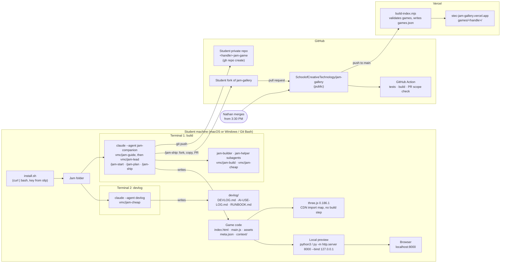

# Game Dev Stack

How the pieces of the jam fit together. You only work in the left box; `/jam-ship` and Nathan handle the rest.

| Layer | Tool | Notes |
|---|---|---|
| Schedule | 11:00 onboarding; to 4:00 PM | Plan 11:30 to 12:45; build from 1:00; playtests after M2 and M3; ship by **3:30 PM**. See `AGENTS.md`. |
| Game | three.js 0.186.1 | Loaded from a CDN in `index.html`. Plain HTML and JavaScript modules; nothing to install. |
| AI | Claude Code on jam models (Vercel AI Gateway, capped key) | Build terminal (`jam-companion`) plans with you and sends tasks to builder subagents. Devlog terminal (`devlog`) records your decisions in your words. |
| Preview | Python or Node | `python3 -m http.server 8000 --bind 127.0.0.1` (Windows: `py -m http.server 8000 --bind 127.0.0.1`) then http://localhost:8000. |
| Saving work | git + GitHub CLI (`gh`) | Your own private repo, created by `/jam-start` if you want one. |
| Publishing | GitHub + Vercel | `/jam-ship` opens a pull request to the public gallery; once merged, the game goes live at https://stec-jam-gallery.vercel.app. |

## Inspiration

Games built on the same stack. Play them, then tell the build terminal what you liked.

| Game | What to notice | Stack |
|---|---|---|
| [fly.pieter.com](https://fly.pieter.com/) | A whole multiplayer flight game coded with AI. Simple shapes, big feel. | three.js with plain script tags, no build step (same as yours) |
| [Astray](https://wwwtyro.github.io/Astray/) | A 3D ball maze: one mechanic, done well, in a few small files. | three.js, plain scripts, GitHub Pages |
| [bruno-simon.com](https://bruno-simon.com/) | Drive a toy car around a portfolio. Physics, polish, personality. | three.js with a build step (Vite): the polished upper bound |

More to browse:
- [Vibe Jam](https://vibej.am/2026/): a yearly jam for AI-coded browser games. Most entries use three.js.
- [three.js forum game showcase](https://discourse.threejs.org/tag/game): recent games, many with source code.
